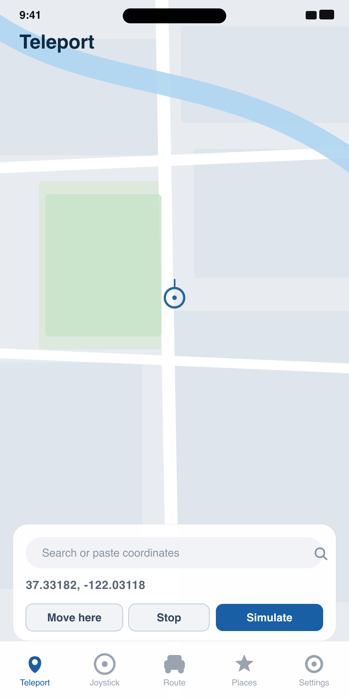
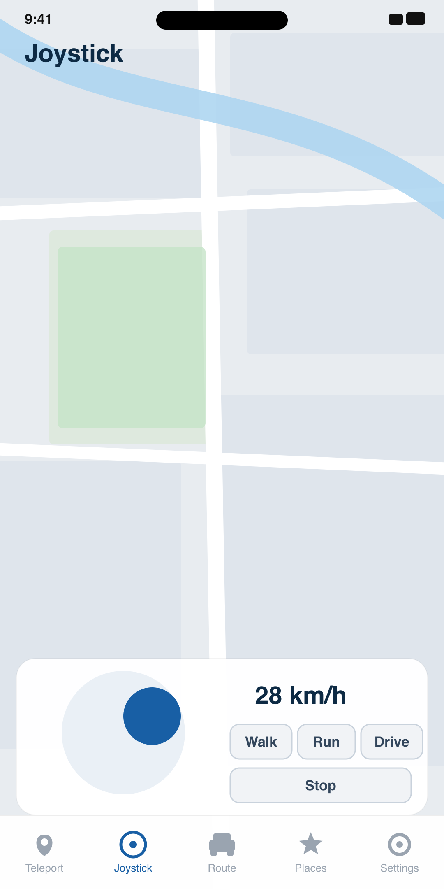
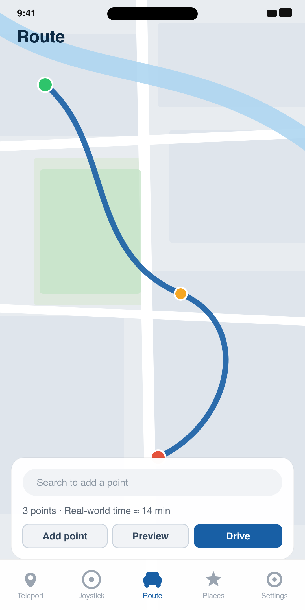

# Wander

### Set your iPhone's location to anywhere on Earth — no jailbreak.

Teleport with a tap, roam with a live on-screen joystick, or drive a multi-stop route that follows roads. Cross-platform for iPhone, Android, Mac &amp; Windows, with a free plan that refills — a lower-priced alternative to apps like **iMyFone AnyTo** and **Tenorshare iAnyGo**.

Use it to test location-based apps, preview places before a trip, keep your exact location private, and play location-based games (some games may not accept a changed location; see the FAQ below).

 

 

### 👉 [**⬇️ Download at wanderspoofer.com**](https://wanderspoofer.com/#download) &nbsp;·&nbsp; [**⭐ Star this repo**](https://github.com/faisal-nabulsi/Wander)

**Everything — the app, all downloads, and the step-by-step setup guide — lives at [wanderspoofer.com](https://wanderspoofer.com).**

 

**⭐ [Star Wander on GitHub](https://github.com/faisal-nabulsi/Wander) — it's free, takes one click, and helps more people find an affordable alternative to the paid location changers.**

 

**💬 [Join the Wander Discord](https://discord.gg/gfHdsRXUVA) — setup help, release updates, and feature requests. Stuck on install? Ask here and get unstuck fast.**

 

  

<table>
<tr>
<td align="center"> <b>📍 One-tap teleport</b></td>
<td align="center"> <b>🕹️ Live joystick</b></td>
<td align="center"> <b>🛣️ Multi-stop routes</b></td>
</tr>
</table>

---

## ✨ Features

**Move anywhere**
- 📍 **One-tap Teleport** — search an address, paste coordinates or a Plus Code, drop a pin, or spin a 3D globe and tap to land.
- 🕹️ **Live Joystick** — a 360° on-screen stick that moves your location in real time, with walk, run and drive presets and a speed slider.
- 🛣️ **Multi-stop Routes** — chain any number of stops into one trip (on iPhone, free-plan multi-stop routes count toward the 3 a month; Wander Desktop makes them Pro) with snap-to-roads, **speed & ETA**, smooth motion, and auto-loop _(Pro)_. **Drag to reorder** waypoints and **reverse** the whole route in one tap.
- 🚗 **Transport modes** — pick how a route is traveled: **Driving**, **Walking**, **Cycling** _(Pro)_, **Public transport** _(Pro)_, or **Plane** (a great-circle flight path; simulated climb, cruise and descent altitude on Android).
- ✈️ **Flight planner** — pick two searchable airports, or add a time range to pick from generated example flights, then fly the great-circle route. Uses a bundled airport dataset — no API.
- 🎮 **Games mode** _(free on iPhone; Pro in Wander Desktop)_ — after each jump, a **timer** shows a suggested wait based on how far you moved, with an optional lock until it ends, plus presets for popular location-based games (full list in the app). It can't stop a game from warning or banning your account.

**See before you go**
- 👀 **Street View preview** _(Pro)_ and **satellite / hybrid** map views to land in exactly the right spot.
- 🗺️ **Offline maps** — download a map region over Wi-Fi, then pan, zoom and teleport with no connection (map tiles © CARTO, map data © OpenStreetMap contributors).
- 🕒 **Local time & weather** at the location you set, with a heads-up when your phone's time zone doesn't match it.

**Find & organize**
- 🔎 **Smart search** with autocomplete, plus **AI natural-language teleport** _(Pro)_ — "take me to Times Square."
- ⭐ **Favorites** in folders with tags & notes, **teleport history** with undo, and **save-loops** _(Pro)_.

**Plan & automate**
- ⏺️ **Record & replay** _(Pro)_ a real route, or queue a **timed itinerary** _(Pro)_ ("stay 1hr, then route to there").
- 📅 **Scheduling** — turn a saved location on and off automatically at times you choose. Runs even when the app is closed on Android; while backgrounded on iOS.
- 📡 **Geofence triggers** — switch back to your real location when you reach or leave a place you pick. _(iOS &amp; Android)_
- 🧠 **AI day planner** _(Pro)_ — describe a day (or tap surprise-me) and it suggests a day of stops. Plus a read-only board of current in-game events.

**Movement options**
- 🌊 **Distance-jump smoothing** — big teleports glide over a few seconds instead of snapping across the map. _(iOS &amp; Android)_
- 🌧️ **Weather-aware pacing** — an optional setting slows routes down in rain and snow. _(iOS &amp; Android)_
- 🧊 **Privacy toggles** — **Hold-still** (natural drift off on iPhone, **Hold perfectly still** on Android) and **Approximate (~3–5 km)** location modes. _(iOS &amp; Android)_
- 🛰️ **GPS drift** — small random movement around a held spot, on by default (on iPhone, turn off **Simulated jitter (natural drift)** in Settings to stop it; on Android, turn on **Hold perfectly still**).
- 🌐 **IP note** — a short explainer that apps can also estimate where you are from your IP address. _(iOS; desktop has the same IP card)_

**Your data**
- 📂 **GPX, KML, GeoJSON &amp; CSV import**, **GPX export**, full **backup / restore**, and **sync** of saved places and routes across your devices _(Pro)_.
- 🌐 **10 languages** — English plus partial translations into Spanish, French, German, Portuguese (Brazil), Italian, Japanese, Korean, Chinese (Simplified) and Russian.

**Setup & updates**
- ↩️ **Back to real location** — one tap returns your phone to its real location, plus **Dark Mode**.
- 📱 **Quick Settings tile & home-screen widget** for one-tap teleport _(Android)_.
- 📶 **Cellular support** — start the connection with a quick Airplane Mode toggle, then it keeps working on cellular without Wi-Fi.
- 🔓 **No jailbreak** — runs on a normal iPhone with Developer Mode turned on.
- 🔄 **Over-the-air self-updates** — after setup it updates and re-signs itself from the phone; keep your Apple ID signed in inside Wander and open it with the tunnel connected every couple of days. It re-signs itself at launch once 2 days or fewer are left on the free 7-day signature, and you can also run self-refresh by hand in Settings.

Start on the **free plan**: 1 teleport every day, plus 15 minutes of joystick and 3 routes every month. **Wander Pro** ($3.99 a month, $36 a year, or $80 once) makes them unlimited and adds Cycling and Public transport routes, auto-loop and saved routes, route recording, timed itineraries, AI teleport and the AI day planner, Street View, and sync.

---

## ⚖️ Wander vs. iMyFone AnyTo

| | **Wander** | iMyFone AnyTo (VIP plan) |
|---|:---:|:---:|
| **Monthly** | **$3.99** | $14.99 |
| **Yearly** | **$36** | $59.99 |
| **Lifetime** | **$80** | $89.99 |
| **Free use** | Free plan that refills: 1 teleport a day, plus 15 joystick minutes and 3 routes a month | Limited free trial |
| **No jailbreak** | ✅ | ✅ |
| **Teleport, joystick, multi-stop routes** | ✅ | ✅ |
| **Open source** | ✅ iPhone and desktop apps | ❌ |

AnyTo prices are its VIP plan as listed on [iMyFone's store](https://www.imyfone.com/location-changer/purchase/) on 15 November 2026; its SVIP plan costs more. Prices change often and sales can lower them, so check both stores.

Wander also includes a games mode with a timer, transport modes including flights, AI natural-language teleport, GPX & KML import, GPX export, cellular support, over-the-air self-updates, and one Pro account for iOS · Android · macOS · Windows (up to 3 devices).

---

## ⬇️ Get Wander

Wander isn't on the App Store, but installing it is quick and needs **no jailbreak and no paid developer account**.

### 👉 [**Get it at wanderspoofer.com**](https://wanderspoofer.com/#download)

The site walks you through the whole thing with the free **Wander Installer** and always has the latest build. Prefer to grab the raw app? [`Wander.ipa`](https://github.com/faisal-nabulsi/Wander/releases/latest) is on the Releases page.

> ⚠️ **First launch — trust the developer.** The first time you tap Wander, iPhone shows **"Untrusted Developer"** and won't open it (normal for any sideloaded app). Fix it once: **Settings → General → VPN & Device Management** → tap your **Apple ID email** under *Developer App* → **Trust**. Then enable **Settings → Privacy & Security → Developer Mode** when prompted (it only appears after Wander is installed). Wander opens normally from then on.

> 💻 **Prefer to set your location from your computer?** **Wander Desktop** (Mac & Windows) teleports, walks with a joystick, and drives routes right from your desktop — [download it at wanderspoofer.com](https://wanderspoofer.com/#download).

---

## 💬 Community & support

**[Join the Wander Discord →](https://discord.gg/gfHdsRXUVA)** for setup help, release updates, and feature requests. It's the fastest way to get unstuck during install and to hear about new builds first.

- 🌐 **Website & downloads:** [wanderspoofer.com](https://wanderspoofer.com)
- 💬 **Discord:** [join the server](https://discord.gg/gfHdsRXUVA) — setup help, updates, and requests.
- ⭐ **Star the repo:** [give Wander a star](https://github.com/faisal-nabulsi/Wander) — it's the easiest way to support the project.
- 🐛 **Bugs / feature requests:** open an [issue](https://github.com/faisal-nabulsi/Wander/issues).

---

## 🤔 Why Wander?

The other location changers work. Wander Pro is $3.99 a month, $36 a year, or $80 once, which is less than AnyTo's VIP plan (see the table above) and less than Tenorshare iAnyGo's 1-PC plans as listed on 26 November 2026. Prices change often. One Pro account works on iPhone, Android, Mac and Windows: teleport, joystick, routes and more, with no jailbreak. Its **free plan** refills every day and month, so you can keep using it without paying.

---

## ❓ FAQ

**Is Wander free?**
There is a free plan that refills: 1 teleport every day, plus 15 minutes of joystick and 3 routes every month. **Wander Pro** makes those unlimited and adds Cycling and Public transport routes, auto-loop and saved routes, route recording, timed itineraries, AI teleport and the AI day planner, Street View, and sync, for **$3.99 a month, $36 a year, or $80 once**. One Pro account covers iPhone, Android, Mac and Windows on up to 3 devices.

**Does it need a jailbreak?**
No. Wander runs on a **stock iPhone** with Developer Mode turned on, with no jailbreak and no paid Apple developer account.

**Which platforms does it support?**
iPhone (iOS), Android, macOS and Windows — one account across all of them.

**Is Wander an alternative to iMyFone AnyTo, Tenorshare iAnyGo, or AnyGo?**
Yes. It does the same core things — teleport, live joystick walking, and multi-stop routes with no jailbreak — with a free plan that refills and lower prices than AnyTo's VIP plan on every billing period (as listed on 15 November 2026). See the [comparison table](#️-wander-vs-imyfone-anyto) above.

**Can I use it with location-based games?**
Yes, with limits. Wander changes the location your phone reports and doesn't modify any other app, so most apps see the new location. Some games check whether a location is simulated and may not accept the location Wander sets. Games mode adds a timer that suggests how long to wait after each jump; it's only a suggestion. Many games don't allow changing your location, and using Wander with them can lead to warnings, suspensions or a permanent ban, which Wander can't prevent. **Check the rules of each game you play.**

**How do I install it without the App Store?**
About 10 minutes the first time on iPhone (a one-time setup with a Mac or Windows PC), guided by the free **Wander Installer**. Android takes a couple of minutes. Start at **[wanderspoofer.com](https://wanderspoofer.com/#download)**.

---

## 📦 The Wander project

Wander is cross-platform. Its public repos:

- **[Wander](https://github.com/faisal-nabulsi/Wander)** — the iPhone app (this repo).
- **[wander-desktop](https://github.com/faisal-nabulsi/wander-desktop)** — the Mac & Windows app (sets an iPhone's location over USB or Wi-Fi).
- **[wander-site](https://github.com/faisal-nabulsi/wander-site)** — the website & download guide.
- **[Wander-Installer](https://github.com/faisal-nabulsi/Wander-Installer)** — the desktop sideloader that installs Wander (based on nab138's iloader).

---

## 📜 Credits & License

Wander is powered by jkcoxson's [`idevice`](https://github.com/jkcoxson/idevice) library and builds on the [StikDebug](https://github.com/StephenDev0/StikDebug) project — huge thanks to those projects. The events board uses data from [ScrapedDuck](https://github.com/bigfoott/ScrapedDuck), collected from [LeekDuck](https://leekduck.com), and weather data comes from [Open-Meteo](https://open-meteo.com) (CC BY 4.0).

*Use Wander responsibly and legally. Many games and apps don't allow changing your location. Using Wander with them can lead to warnings, suspensions or a permanent ban, and Wander can't prevent that. You are responsible for following the rules of the apps you use.*

*Don't use Wander to deceive, track or harass anyone, or to get around location checks in banking, betting, delivery-driver, attendance or legal apps.*

*Wander is an independent project. It is not affiliated with, endorsed by, or sponsored by Apple, Google, Microsoft, iMyFone, Tenorshare or any game publisher. All product and company names are trademarks of their owners.*

---

### ⭐ Star this repo if Wander helped you.

**[🌐 wanderspoofer.com](https://wanderspoofer.com)** &nbsp;·&nbsp; **[⬇️ Download](https://wanderspoofer.com/#download)** &nbsp;·&nbsp; **[💬 Discord](https://discord.gg/gfHdsRXUVA)**

